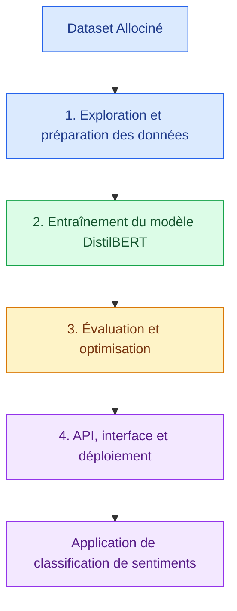
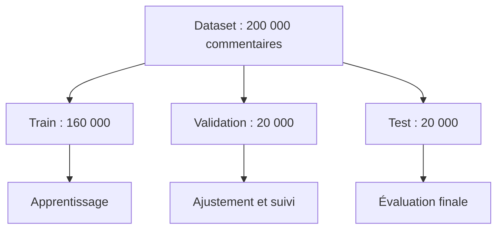

# From Training to Deployment: Mise en pratique d'un modèle de Deep Learning

## 1. Introduction générale

Aujourd'hui, les plateformes numériques produisent une grande quantité de données textuelles : commentaires, avis clients, publications et messages.

L'analyse de ces données permet de comprendre les opinions et les sentiments exprimés par les utilisateurs.

Dans ce projet, nous nous intéressons à l'analyse de sentiments (*Sentiment Analysis*), une application du traitement automatique du langage naturel (NLP).

L'objectif est de développer un système capable d'analyser un commentaire de film écrit en français et de déterminer automatiquement s'il exprime un sentiment positif ou négatif.

Pour réaliser cette tâche, nous utilisons un modèle de Deep Learning basé sur l'architecture Transformer : **DistilBERT multilingue**.

Le projet ne se limite pas à entraîner un modèle. Il suit un pipeline complet, depuis la préparation des données jusqu'au déploiement de l'application.

## 2. Problématique

Lorsqu'un utilisateur publie un commentaire sur un film, son texte contient des informations permettant de comprendre son opinion.

Cependant, analyser manuellement des milliers de commentaires prend beaucoup de temps.

La problématique de notre projet est donc la suivante :

**Comment développer un système capable de comprendre automatiquement des commentaires de films en français et de les classer selon leur sentiment ?**

Notre système doit identifier deux catégories :

- Classe 0 : sentiment négatif.
- Classe 1 : sentiment positif.

Exemple :

| Commentaire | Sentiment attendu |
|---|---|
| Ce film est magnifique, j'ai adoré ! | Positif (1) |
| Une histoire décevante et un film ennuyeux. | Négatif (0) |

Il s'agit d'une tâche de classification binaire de texte.

## 3. Objectifs du projet

Les objectifs sont :

1. Comprendre et préparer un jeu de données textuelles.
2. Explorer et nettoyer les données.
3. Transformer les commentaires en représentations numériques compréhensibles par le modèle.
4. Sélectionner et entraîner un modèle de Deep Learning.
5. Évaluer les performances du modèle.
6. Préparer le modèle pour son utilisation dans une application.
7. Déployer une solution permettant de tester le modèle.

## 4. Pipeline global du projet

Le projet est organisé en quatre grandes phases.



### Répartition du travail

| Responsable | Missions |
|---|---|
| Personne 1 | Dataset, exploration, nettoyage, tokenisation et préparation |
| Personne 2 | Entraînement, hyperparamètres et suivi des expériences |
| Personne 3 | Évaluation, analyse des erreurs et optimisation |
| Personne 4 | API, interface utilisateur, Docker et déploiement |

**Cette documentation présente principalement la première phase, réalisée par la personne 1.**

---

# PARTIE 1 — EXPLORATION ET PRÉPARATION DES DONNÉES

## 5. Présentation du dataset

### 5.1 Qu'est-ce qu'un dataset ?

Un dataset est un ensemble de données organisé que l'on utilise pour apprendre à un modèle de Machine Learning ou de Deep Learning à réaliser une tâche.

Dans notre cas, chaque ligne représente un commentaire de film accompagné de son sentiment.

Nous avons choisi le dataset **Allociné**, disponible sur la plateforme Hugging Face.

Source : https://huggingface.co/datasets/tblard/allocine

### 5.2 Pourquoi avoir choisi Allociné ?

Nous avons retenu ce dataset pour plusieurs raisons :

- Les commentaires sont rédigés en français.
- Les données sont déjà associées à des labels de sentiment.
- Le dataset contient suffisamment d'exemples pour entraîner un modèle de Deep Learning.
- Il est directement accessible avec la bibliothèque Hugging Face Datasets.

### 5.3 Structure du dataset

Le dataset est organisé en trois parties :

| Partie | Nombre de commentaires | Utilisation |
|---|---:|---|
| Train | 160 000 | Entraîner le modèle |
| Validation | 20 000 | Suivre et ajuster l'entraînement |
| Test | 20 000 | Évaluer le modèle final |
| **Total** | **200 000** | |

Chaque commentaire possède deux informations :

- `review` : le texte du commentaire.
- `label` : la catégorie de sentiment.

### 5.4 Pourquoi trois ensembles de données ?

Il est important de ne pas utiliser les mêmes données pour toutes les étapes.

- **Train :** le modèle apprend à reconnaître les sentiments à partir des exemples.
- **Validation :** permet de suivre son évolution pendant l'entraînement et de comparer les configurations.
- **Test :** permet de mesurer ses performances finales sur des données non utilisées pour l'apprentissage.

Schématiquement :



## 6. Environnement technique

Nous avons utilisé Python et plusieurs bibliothèques spécialisées.

| Outil | Rôle |
|---|---|
| Python | Langage de programmation |
| VS Code | Environnement de développement |
| Jupyter Notebook | Exécution du code étape par étape |
| uv | Gestion de l'environnement Python et des dépendances |
| Hugging Face Datasets | Chargement du dataset |
| Pandas | Manipulation et nettoyage des données |
| NumPy | Calculs numériques |
| Matplotlib | Création des graphiques |
| Seaborn | Visualisation statistique |
| Transformers | Chargement du tokenizer DistilBERT |

### 6.1 Création de l'environnement virtuel

Un environnement virtuel permet d'isoler les bibliothèques utilisées par le projet des autres installations Python de l'ordinateur.

Commande utilisée :

```powershell
uv venv --python 3.12
```

Activation sous PowerShell :

```powershell
.\.venv\Scripts\Activate.ps1
```

Installation des bibliothèques :

```powershell
uv pip install --python .venv\Scripts\python.exe datasets pandas numpy matplotlib seaborn transformers ipykernel
```

**Pourquoi utiliser un environnement virtuel ?**

Pour éviter les conflits entre les versions des bibliothèques et conserver un environnement propre au projet.

### 6.2 Organisation du projet

Les dossiers principaux du projet sont organisés de la manière suivante :

```text
from-training-to-deployment/
│
├── data/
│   └── processed/
│       └── allocine_train_clean.csv
│
├── notebooks/
│   └── 01_data_exploration.ipynb
│
├── src/
├── models/
├── api/
├── app/
├── docker/
├── docs/
├── reports/
│
└── README.md
```

Le dossier `notebooks` contient le travail exploratoire.

Le dossier `data/processed` contient les données préparées et exportées.

Les autres dossiers sont destinés aux différentes phases du projet.

---

## 7. Chargement des données

### 7.1 Comprendre le chargement

Nous devons d'abord récupérer les données depuis Hugging Face pour pouvoir les analyser.

La bibliothèque `datasets` permet de charger directement le dataset sans télécharger manuellement chaque fichier.

### 7.2 Code utilisé

```python
from datasets import load_dataset

# Charger le dataset Allociné
dataset = load_dataset("tblard/allocine")

# Afficher sa structure
print(dataset)
```

### 7.3 Explication

- `load_dataset()` récupère le dataset depuis Hugging Face.
- `dataset` contient les trois ensembles : train, validation et test.
- `print(dataset)` affiche leur structure et leur nombre de lignes.

Nous avons ensuite converti le jeu d'entraînement en DataFrame Pandas :

```python
df_train = dataset["train"].to_pandas()
```

Un DataFrame est une structure de données sous forme de tableau, composée de lignes et de colonnes.

Cela facilite les opérations d'exploration et de nettoyage.

---

## 8. Exploration des données (EDA)

EDA signifie *Exploratory Data Analysis*, ou analyse exploratoire des données.

Avant de préparer les données pour le modèle, il faut comprendre leur contenu et vérifier leur qualité.

### 8.1 Vérification de la structure

Nous avons commencé par examiner les dimensions du dataset et ses colonnes.

```python
print("Dimensions :", df_train.shape)
print("Colonnes :", df_train.columns.tolist())
print(df_train.head())
```

Le résultat montre :

- 160 000 lignes.
- 2 colonnes : `review` et `label`.

### 8.2 Comprendre la distribution des classes

Un modèle de classification doit apprendre à distinguer les différentes catégories.

Il est donc important de vérifier si les classes sont équilibrées.

Code utilisé :

```python
print(df_train["label"].value_counts())
print(df_train["label"].value_counts(normalize=True) * 100)
```

Résultats :

| Classe | Nombre | Pourcentage |
|---|---:|---:|
| Négatif (0) | 79 413 | 49,63 % |
| Positif (1) | 80 587 | 50,37 % |

**Interprétation :**

Les deux classes sont presque équilibrées.

Cela signifie que le dataset ne contient pas une forte domination d'une seule catégorie.

C'est un point positif pour préparer un problème de classification binaire.

### 8.3 Vérification des valeurs manquantes

Une valeur manquante signifie qu'une information attendue n'est pas présente dans une ligne.

Par exemple, un commentaire sans texte ou une ligne sans label.

Code utilisé :

```python
print(df_train.isnull().sum())
```

Résultat :

| Colonne | Valeurs manquantes |
|---|---:|
| review | 0 |
| label | 0 |

Nous avons également vérifié les commentaires vides.

```python
print("Commentaires vides :",
      df_train["review"].str.strip().eq("").sum())
```

Résultat : aucun commentaire vide.

**Décision :** aucune suppression n'est nécessaire pour traiter les valeurs manquantes ou les textes vides.

### 8.4 Détection des doublons

Un doublon correspond à un commentaire qui apparaît plusieurs fois.

Les doublons peuvent donner trop d'importance à certains exemples pendant l'entraînement.

Code utilisé :

```python
print(df_train["review"].duplicated().sum())
```

Résultat : 539 occurrences supplémentaires de commentaires déjà présents.

Pour examiner toutes les lignes concernées :

```python
duplicates = df_train[
    df_train["review"].duplicated(keep=False)
]

print("Nombre de lignes contenant des commentaires dupliqués :",
      len(duplicates))

print("Nombre de doublons supplémentaires :",
      df_train["review"].duplicated().sum())
```

Cette distinction est importante :

- Les lignes contenant des textes répétés incluent la première occurrence.
- Les doublons supplémentaires comptent uniquement les répétitions après la première occurrence.

### 8.5 Détection des labels contradictoires

Un problème supplémentaire peut apparaître : un même commentaire peut être associé à plusieurs labels.

Exemple :

| Commentaire | Label |
|---|---:|
| Exemple de commentaire | 0 |
| Exemple de commentaire | 1 |

Le même texte possède alors deux annotations différentes.

Il s'agit d'un conflit de labels.

Code utilisé :

```python
label_conflicts = duplicates.groupby("review")["label"].nunique()

conflict_texts = label_conflicts[
    label_conflicts > 1
].index

conflict_rows = df_train[
    df_train["review"].isin(conflict_texts)
]

print("Nombre de textes conflictuels :", len(conflict_texts))
print("Nombre de lignes concernées :", len(conflict_rows))
```

Résultats :

- 5 textes conflictuels.
- 15 lignes concernées.

**Pourquoi les supprimer ?**

Parce qu'un même texte associé à deux sentiments différents peut rendre l'apprentissage ambigu.

Nous avons donc choisi de retirer ces textes du jeu d'entraînement.

---

## 9. Nettoyage des données

Après l'analyse, nous avons créé une nouvelle version du DataFrame contenant les données nettoyées.

Nous avons conservé le DataFrame original `df_train` afin de ne pas perdre les données de départ.

Code utilisé :

```python
df_train_clean = df_train[
    ~df_train["review"].isin(conflict_texts)
].drop_duplicates(
    subset=["review"],
    keep="first"
).reset_index(drop=True)
```

### Explication du code

- `~` inverse la condition : nous conservons les commentaires qui ne sont pas conflictuels.
- `isin()` vérifie si un commentaire appartient à la liste des textes conflictuels.
- `drop_duplicates()` supprime les répétitions.
- `subset=["review"]` indique que nous recherchons les doublons à partir du texte.
- `keep="first"` conserve la première occurrence.
- `reset_index()` réorganise les numéros des lignes après le nettoyage.

### Résultat du nettoyage

| Indicateur | Résultat |
|---|---:|
| Nombre initial de lignes | 160 000 |
| Nombre final de lignes | 159 456 |
| Lignes supprimées | 544 |

Nous avons donc conservé 159 456 commentaires uniques et sans conflit de labels.

**Attention :** ce nettoyage concerne uniquement le jeu d'entraînement. Les jeux de validation et de test n'ont pas été modifiés dans cette phase.

### 9.1 Vérification après nettoyage

Nous avons vérifié la distribution des classes après le nettoyage.

Résultat :

- Classe négative : environ 49,62 %.
- Classe positive : environ 50,38 %.

La distribution reste équilibrée.

Le nettoyage n'a donc pas modifié de manière significative la répartition des sentiments.

---

## 10. Analyse de la longueur des commentaires

Tous les commentaires n'ont pas la même longueur.

Certains contiennent une seule phrase, tandis que d'autres sont beaucoup plus détaillés.

Cette analyse est importante car les modèles Transformer ont une limite sur le nombre de tokens qu'ils peuvent traiter en une seule séquence.

Nous avons calculé deux mesures :

- Le nombre de caractères.
- Le nombre de mots.

Code utilisé :

```python
df_train_clean["char_length"] = (
    df_train_clean["review"].str.len()
)

df_train_clean["word_length"] = (
    df_train_clean["review"].str.split().str.len()
)

print(
    df_train_clean[
        ["char_length", "word_length"]
    ].describe()
)
```

### Résultats

| Indicateur | Caractères | Mots |
|---|---:|---:|
| Moyenne | 543,30 | 91,43 |
| Médiane | 390 | 66 |
| Minimum | 3 | 1 |
| Maximum | 2 000 | 384 |

### Comprendre l'histogramme

Un histogramme permet de visualiser la distribution d'une variable numérique.

Dans notre cas :

- L'axe horizontal représente le nombre de mots ou de caractères.
- L'axe vertical représente le nombre de commentaires.
- Chaque barre représente le nombre de commentaires appartenant à un intervalle de longueur.

Cette visualisation permet de constater que les commentaires courts et moyens sont nombreux, tandis que les commentaires très longs sont moins fréquents.

---

## 11. Tokenisation avec DistilBERT

### 11.1 Pourquoi la tokenisation ?

Un modèle de Deep Learning ne comprend pas directement les phrases comme un être humain.

Il doit recevoir des données sous forme numérique.

La tokenisation est l'opération qui transforme un texte en une séquence de tokens, puis en identifiants numériques.

Un token peut correspondre à un mot entier, à une partie de mot ou à un signe de ponctuation.

Exemple simplifié :

```text
Texte :
"Ce film est magnifique"

        |
        v

Tokenisation :
["Ce", "film", "est", "magnifique"]

        |
        v

Conversion en identifiants :
[101, 1234, 5678, 9012, 102]
```

Les identifiants ci-dessus sont illustratifs. Les vrais identifiants dépendent du tokenizer utilisé.

### 11.2 Choix du tokenizer

Nous avons choisi le checkpoint :

`distilbert/distilbert-base-multilingual-cased`

Il s'agit d'un modèle pré-entraîné multilingue de la famille DistilBERT.

Pourquoi ce choix ?

- Il prend en charge plusieurs langues, dont le français.
- Il repose sur une architecture Transformer.
- Il est plus léger que BERT dans sa version de référence.
- Il constitue une base adaptée à notre tâche de classification de sentiments.

Le tokenizer associé au checkpoint garantit que les textes sont transformés selon le vocabulaire attendu par le modèle.

### 11.3 Chargement du tokenizer

```python
from transformers import AutoTokenizer

checkpoint = "distilbert/distilbert-base-multilingual-cased"

tokenizer = AutoTokenizer.from_pretrained(checkpoint)
```

`AutoTokenizer` permet de charger automatiquement le tokenizer correspondant au checkpoint sélectionné.

### 11.4 Analyse de la longueur des séquences tokenisées

Le nombre de mots ne correspond pas nécessairement au nombre de tokens.

Par exemple, un mot peut être divisé en plusieurs sous-unités par le tokenizer.

Nous avons donc calculé la longueur réelle des séquences après tokenisation.

```python
token_lengths = []

reviews = df_train_clean["review"].tolist()

for start in range(0, len(reviews), 1000):
    batch = reviews[start:start + 1000]

    encoded = tokenizer(
        batch,
        add_special_tokens=True,
        truncation=False
    )

    token_lengths.extend(
        [len(ids) for ids in encoded["input_ids"]]
    )

df_train_clean["token_length"] = token_lengths

print(df_train_clean["token_length"].describe())
```

### Résultats obtenus

| Indicateur | Tokens |
|---|---:|
| Moyenne | 147,45 |
| Médiane | 107 |
| 95e percentile | 405 |
| Maximum | 716 |

Le 95e percentile signifie que 95 % des commentaires ont une longueur inférieure ou égale à 405 tokens.

Nous avons également constaté que seulement 0,99 % des commentaires dépassent 512 tokens.

### 11.5 Choix de la longueur maximale

Nous avons retenu une longueur maximale de 512 tokens.

Cette décision repose sur deux éléments :

1. Respecter la limite maximale du modèle sélectionné.
2. Conserver presque tous les commentaires sans troncature.

Les commentaires dépassant 512 tokens seront tronqués lors de la préparation des séquences.

### 11.6 Padding et Truncation

Deux mécanismes sont utilisés pour préparer les séquences.

**Padding :**

Le padding consiste à ajouter des tokens de remplissage aux séquences trop courtes afin qu'elles aient toutes la même longueur.

**Truncation :**

La troncature consiste à couper les séquences trop longues pour respecter la longueur maximale définie.

Schéma simplifié :

```text
Commentaire court
       |
       v
Tokens + Padding
       |
       v
Séquence de 512 positions


Commentaire long
       |
       v
Tokens + Truncation
       |
       v
Séquence de 512 positions
```

### 11.7 Comprendre les Input IDs et Attention Mask

Lors de la tokenisation, le tokenizer produit notamment deux informations importantes :

**Input IDs :**

Ce sont les identifiants numériques des tokens. Ils représentent le texte sous une forme exploitable par le modèle.

**Attention Mask :**

Ce masque indique au modèle quelles positions correspondent à de vrais tokens et quelles positions correspondent au padding.

- `1` : token réel.
- `0` : token de remplissage.

Exemple simplifié :

```text
Input IDs :
[101, 234, 567, 102, 0, 0]

Attention Mask :
[ 1,   1,   1,   1, 0, 0]
```

Le modèle peut ainsi distinguer le contenu du texte des positions ajoutées uniquement pour uniformiser la longueur.

### 11.8 Test de tokenisation

Nous avons effectué un test sur un commentaire réel :

```python
example = df_train_clean["review"].iloc[0]

encoded_example = tokenizer(
    example,
    padding="max_length",
    truncation=True,
    max_length=512
)

print("Nombre de tokens :", len(encoded_example["input_ids"]))
print("Input IDs :", encoded_example["input_ids"][:15])
print("Attention Mask :", encoded_example["attention_mask"][:15])
print("Label :", df_train_clean["label"].iloc[0])
```

Le résultat confirme que le tokenizer produit une séquence de 512 positions.

Ce test a été réalisé sans conversion en tenseur PyTorch, car cette phase ne nécessite pas encore l'entraînement du modèle.

---

## 12. Configuration finale du tokenizer

Après les analyses, nous avons retenu la configuration suivante :

```python
tokenizer_config = {
    "checkpoint": checkpoint,
    "max_length": 512,
    "padding": "max_length",
    "truncation": True
}

print(tokenizer_config)
```

Cette configuration sera transmise à la personne responsable de l'entraînement.

Elle permet de conserver les mêmes paramètres de tokenisation dans la suite du projet.

---

## 13. Exportation des données nettoyées

Une fois le nettoyage terminé, nous avons préparé un fichier contenant uniquement les colonnes nécessaires à la classification.

Nous avons volontairement exclu les colonnes ajoutées pour les analyses exploratoires, comme `char_length`, `word_length` et `token_length`.

Code utilisé :

```python
df_train_export = df_train_clean[["review", "label"]]

df_train_export.to_csv(
    "../data/processed/allocine_train_clean.csv",
    index=False,
    encoding="utf-8"
)
```

### Pourquoi exporter les données ?

L'exportation permet de transmettre le travail effectué à la personne responsable de l'entraînement sans lui demander de refaire le nettoyage.

Le fichier CSV est enregistré dans :

`data/processed/allocine_train_clean.csv`

### Vérification de l'exportation

Nous avons rechargé le fichier pour vérifier son intégrité.

```python
import pandas as pd

df_check = pd.read_csv(
    "../data/processed/allocine_train_clean.csv"
)

print("Dimensions :", df_check.shape)
print("Colonnes :", df_check.columns.tolist())
print(df_check.isnull().sum())
```

Résultat obtenu :

```text
Dimensions : (159456, 2)

Colonnes :
['review', 'label']

Valeurs manquantes :
review    0
label     0
```

Le fichier a donc été correctement exporté.

---

## 14. Résumé des résultats de la première phase

| Étape | Résultat |
|---|---|
| Dataset initial | 160 000 commentaires d'entraînement |
| Valeurs manquantes | 0 |
| Commentaires vides | 0 |
| Textes conflictuels | 5 |
| Lignes concernées par les conflits | 15 |
| Doublons supplémentaires détectés | 539 |
| Dataset nettoyé | 159 456 commentaires |
| Distribution des classes | Toujours équilibrée |
| Longueur maximale retenue | 512 tokens |
| Commentaires dépassant 512 tokens | 0,99 % |
| Fichier exporté | `allocine_train_clean.csv` |

## 15. Passage à la phase d'entraînement

La première phase est terminée.

Les données d'entraînement ont été explorées, nettoyées et exportées. Le tokenizer et ses paramètres ont également été sélectionnés.

Le travail est maintenant transmis à la personne responsable de l'entraînement.

### Éléments transmis

- Le fichier `allocine_train_clean.csv`.
- Le checkpoint `distilbert/distilbert-base-multilingual-cased`.
- La longueur maximale de 512 tokens.
- La configuration de padding.
- La configuration de troncature.

**Point important :** seul le jeu d'entraînement a été nettoyé et exporté. Les jeux de validation et de test doivent être récupérés séparément depuis le dataset Hugging Face.

La prochaine phase consistera à utiliser ces données pour entraîner et ajuster le modèle DistilBERT afin qu'il apprenne à classifier les commentaires français selon leur sentiment.

---

