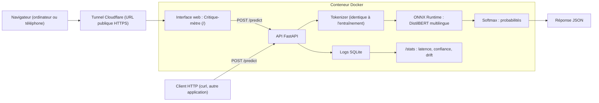

# PARTIE 4 : API, interface, Docker et déploiement

## 1. Objectif

Rendre le modèle utilisable par n'importe qui, depuis une URL publique.
On donne une critique de film en français, et l'application répond si elle est positive ou négative, avec un niveau de confiance.

## 2. Architecture



**Choix techniques**

| Choix | Pourquoi |
|---|---|
| ONNX Runtime plutôt que PyTorch | Format portable, image Docker beaucoup plus légère, inférence CPU rapide |
| FastAPI | Validation automatique des entrées (Pydantic), documentation Swagger sur `/docs`, rapide |
| Interface web sur mesure (HTML/CSS/JS) | Elle appelle l'API REST comme n'importe quel client. Elle affiche le verdict, les étapes du pipeline et le monitoring en direct |
| Gradio sur `/ui/` | Interface alternative, générée automatiquement |
| Pas de padding à l'inférence | Un texte à la fois : inutile de compléter jusqu'à 512 tokens. Le résultat est identique grâce à l'`attention_mask`, mais beaucoup plus rapide |
| Docker | La même image tourne sur un Mac, un serveur ou n'importe quel cloud |
| Tunnel Cloudflare | URL publique HTTPS gratuite vers le conteneur, sans configurer de serveur |

**Pourquoi pas Hugging Face Spaces ?** Depuis 2026, les Spaces Gradio et Docker demandent un abonnement payant (PRO).
Grâce à Docker, on a changé d'hébergement sans toucher au code.
Le script `scripts/deploy_space.py` reste disponible pour un compte PRO.
En production, la même image se déploierait sur Google Cloud Run, Render ou AWS, avec une instance d'au moins 2 Go de RAM.

## 3. Organisation

| Fichier | Rôle |
|---|---|
| `api/model.py` | Charge `model.onnx` + `tokenizer.json` + `config.json` et fait la prédiction |
| `api/main.py` | Routes FastAPI ; sert l'interface web et monte Gradio |
| `api/monitoring.py` | Enregistre chaque requête (sans stocker le texte) ; calcule les indicateurs et le drift |
| `app/web/index.html` | Interface web Critique-mètre |
| `app/ui.py` | Interface Gradio (alternative) |
| `docker/Dockerfile` | Image de production |
| `scripts/export_onnx.py` | Checkpoint Hugging Face vers ONNX (+ quantization INT8 en option) |
| `scripts/make_dummy_model.py` | Faux modèle minuscule pour les tests automatiques |
| `scripts/deploy_space.py` | Déploiement sur Hugging Face Spaces (compte PRO requis) |
| `tests/test_api.py` | 11 tests pytest |
| `.github/workflows/ci.yml` | À chaque push : tests, build Docker, test du conteneur |

## 4. Le contrat avec les phases 2 et 3

L'API lit uniquement ces trois fichiers dans `models/` :

| Fichier | Contenu |
|---|---|
| `model.onnx` | Entrées `input_ids`, `attention_mask` (int64) ; sortie `logits` [batch, 2] |
| `tokenizer.json` | Tokenizer de `distilbert/distilbert-base-multilingual-cased` |
| `config.json` | `labels`, `max_length`, `version`, `examples`, `reference` |

**Ce qu'on attend de la personne 2 (entraînement) :**
- Sauvegarder le modèle **et** le tokenizer dans un même dossier :
  `trainer.save_model("checkpoint-final")` puis `tokenizer.save_pretrained("checkpoint-final")`.
- Définir les classes lors de la création du modèle : `id2label={0: "négatif", 1: "positif"}`, `label2id={"négatif": 0, "positif": 1}`.
- Indiquer le `max_length` utilisé.
- Partager le dossier via Google Drive ou Hugging Face Hub. **Pas sur GitHub** : un fichier de plus de 100 Mo est refusé.

**Ce qu'on attend de la personne 3 (évaluation) :** la confiance moyenne du modèle sur le jeu de test,
à ajouter dans `config.json` → `"reference": {"mean_confidence": 0.xx, "mean_tokens": 147.45}`.

## 5. Remplacer le modèle provisoire par le modèle du groupe

Le modèle provisoire (`lxyuan/distilbert-base-multilingual-cased-sentiments-student`) a la même architecture et le même tokenizer que le nôtre. Le remplacement ne touche donc pas au code :

```bash
# 1. Mettre le dossier du checkpoint fine-tuné dans le repo, par exemple dans checkpoint-final/
# 2. Exporter en ONNX (avec quantization INT8)
python scripts/export_onnx.py --checkpoint checkpoint-final --version v1.0 --max-length 512 --quantize
# 3. Vérifier en local
uvicorn api.main:create_app --factory --port 7860
# 4. Reconstruire l'image et relancer
docker build -f docker/Dockerfile -t sentiment-api .
docker run -p 7860:7860 sentiment-api
```

Le script vérifie lui-même que le modèle ONNX donne les mêmes prédictions que le modèle PyTorch.

## 6. Lancer en local

```bash
uv venv --python 3.12 && source .venv/bin/activate     # Windows : .venv\Scripts\Activate.ps1
uv pip install -r requirements-dev.txt
pytest -q

# Modèle provisoire, en attendant le modèle entraîné
uv pip install -r requirements-export.txt
python scripts/export_onnx.py

uvicorn api.main:create_app --factory --port 7860 --reload
```

- `http://localhost:7860` : interface Critique-mètre
- `http://localhost:7860/docs` : documentation de l'API
- `http://localhost:7860/ui/` : interface Gradio

Test de l'API en ligne de commande :

```bash
curl -X POST localhost:7860/predict -H "Content-Type: application/json" \
     -d '{"text": "Ce film est magnifique, j'\''ai adoré !"}'
```

## 7. Docker et mise en ligne

```bash
docker build -f docker/Dockerfile -t sentiment-api .
docker run -p 7860:7860 sentiment-api
```

URL publique avec un tunnel Cloudflare (gratuit, sans compte) :

```bash
brew install cloudflared           # Windows : winget install Cloudflare.cloudflared
cloudflared tunnel --url http://localhost:7860
```

Le tunnel affiche une adresse `https://xxxx.trycloudflare.com`, accessible depuis n'importe quel appareil.
L'adresse change à chaque lancement, et l'ordinateur doit rester allumé.

## 8. Monitoring

Chaque requête est enregistrée avec la classe, la confiance, la latence et le nombre de tokens.
**Le texte n'est jamais stocké**, pour la vie privée. Les indicateurs sont visibles en direct en bas de l'interface et sur `/stats`.

| Indicateur | Ce qu'il montre |
|---|---|
| Latence p50 / p95 | La rapidité ressentie par l'utilisateur |
| Taux d'erreur | La stabilité du service |
| Analyses incertaines | La part des prédictions avec moins de 60 % de confiance |
| Confiance moyenne | Si elle baisse par rapport au jeu de test, les données ont changé (**drift**), même sans labels |
| Longueur des textes | Si les textes reçus sont 2 fois plus courts ou plus longs que les critiques Allociné (147 tokens en moyenne), le modèle travaille hors de son domaine |

## 9. Routes

| Route | Description |
|---|---|
| `GET /` | Interface web Critique-mètre |
| `POST /predict` | `{"text": "..."}` → `label`, `confidence`, `scores`, `uncertain`, `n_tokens`, `truncated`, `latency_ms`, `model_version` |
| `GET /health` | État de l'API, version du modèle, classes, exemples |
| `GET /stats` | Indicateurs de monitoring et drift |
| `GET /docs` | Documentation Swagger |
| `GET /ui/` | Interface Gradio |
