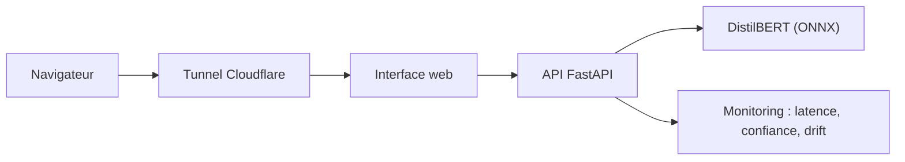

# PARTIE 4 : API, INTERFACE ET DÉPLOIEMENT

Le modèle est servi par une API **FastAPI** avec **ONNX Runtime**. Il est accessible depuis une interface web (le *Critique-mètre*) qui affiche le verdict, les étapes du pipeline et le monitoring en direct. L'ensemble est conteneurisé avec **Docker** et exposé publiquement par un tunnel **Cloudflare**.



Démarrage rapide :

```bash
uv venv --python 3.12 && source .venv/bin/activate
uv pip install -r requirements-dev.txt -r requirements-export.txt
python scripts/export_onnx.py                     # crée models/ (modèle ONNX)
docker build -f docker/Dockerfile -t sentiment-api .
docker run -p 7860:7860 sentiment-api             # http://localhost:7860
cloudflared tunnel --url http://localhost:7860    # URL publique
```

Documentation complète : architecture, contrat avec l'entraînement, remplacement du modèle, monitoring → [`docs/deploiement.md`](docs/deploiement.md)

